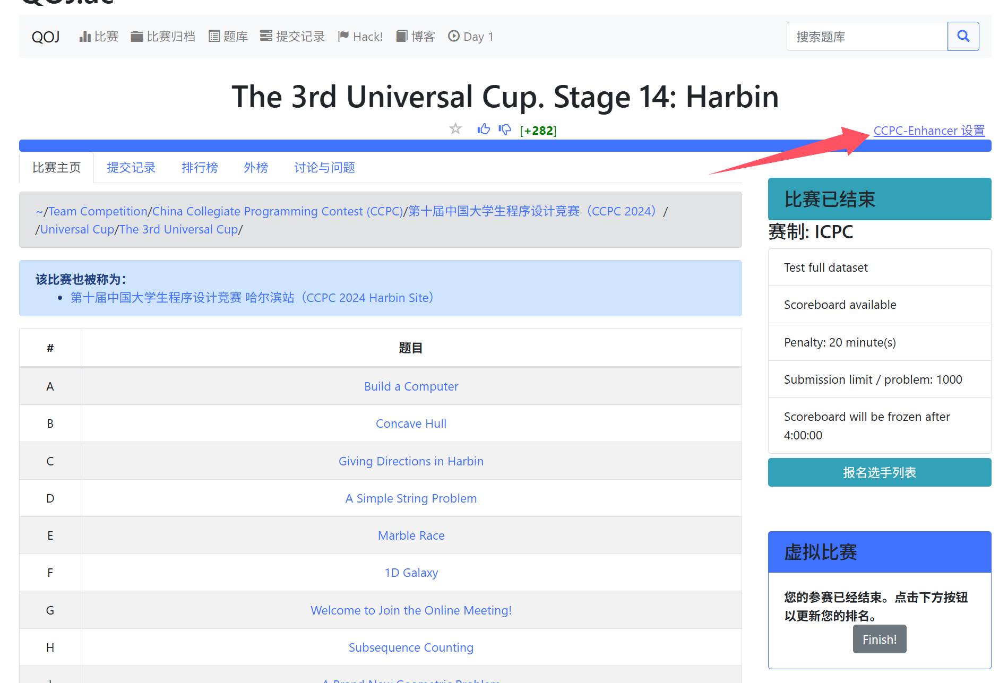
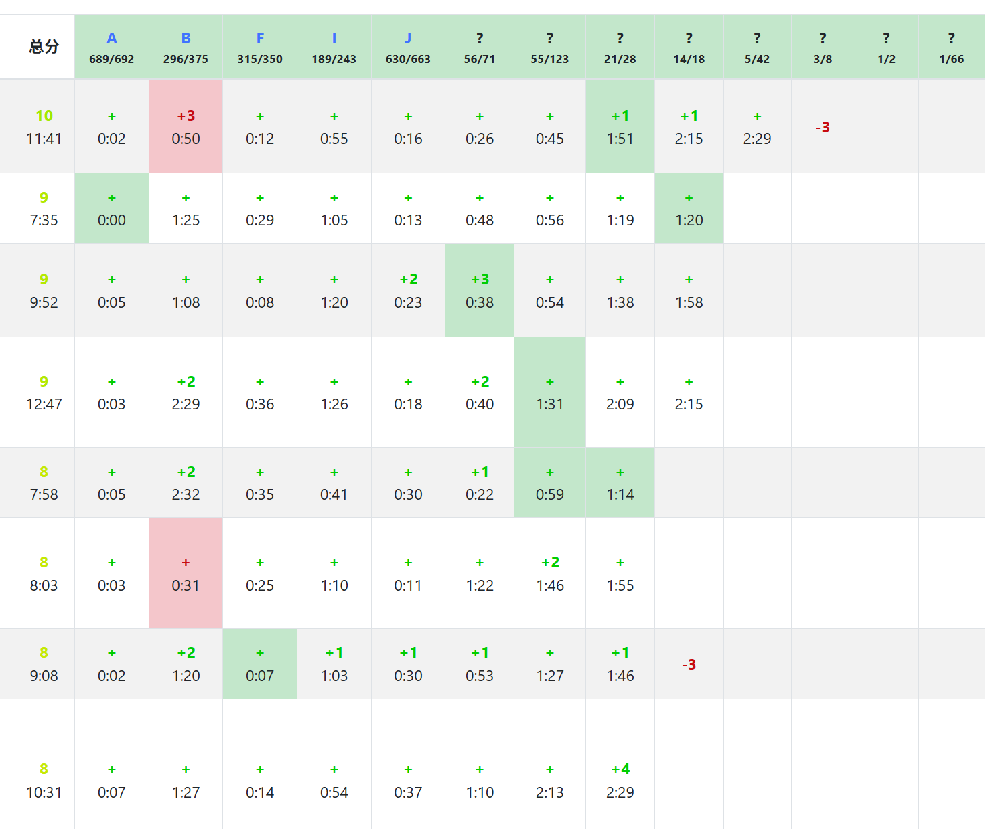

# QOJ CCPC Enhancer

为 QOJ 增加 CCPC 新赛制的榜单显示

## 当前规则与页面显示

可以查看文档 [spec.md](docs/spec.md)

## 安装

你需要先为你的浏览器安装 Tampermonkey ，然后在插件中点击「添加新脚本」，删除默认模板，粘贴 release 中的脚本文件（应为单个js文件）的全部内容并保存。

## 使用

本插件只增加了一个设置入口，你可以通过它选择是否为当前比赛（需为 ICPC 赛制）启用 CCPC 新赛制榜单显示，以及一些选项设置。

它在这：


## 展示



注意，已经揭露题号的列，每一队的提交是与题号对应的；而对于未揭露题号的列，每一队的过题情况进行了独立的排序，因此与表头并不对应

此外，在未揭露题号的列中，我将每个格子设置成了不可跳转，因此无法查看未揭示的题目的提交详情

## 构建

本脚本使用 esbuild 构建，构建脚本位于 `scripts/build.js`

构建命令：
```bash
npm run build
```

## 注意

- 本仓库是一个 Tampermonkey 脚本，需要自行安装 Tampermonkey
- 此脚本仅修改前端页面显示，不会向服务器回传任何数据

## 开源协议

本项目采用 [MIT License](LICENSE) 开源协议。
